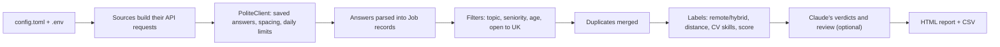

# Data Job Finder

[](https://github.com/IllyaHanslip/data-job-finder/actions/workflows/ci.yml)

Built with [Claude Code](https://claude.com/claude-code).

A Python tool that searches official job APIs for **entry-level data science, AI, statistics and maths roles** that are either **remote and open to UK applicants** or **within about an hour's drive of home** (anywhere in the UK). It writes the results to an HTML page you can filter and a CSV file for Excel.

It never scrapes websites. Every request goes to a documented public API, answers are saved and reused, and each API is called well inside its published limits, so it should not get your IP address blocked.

## What you get

Each run writes two files to `output/`:

- **`jobs_YYYY-MM-DD.html`** opens in your browser. Each job card shows the title, employer, location, remote/hybrid/on-site, a rough distance and drive time, salary, posting date, a description (expandable to the full text), which of your CV skills it mentions, and a link to the original advert to apply. Jobs first seen today are marked **New**, and you can filter by keyword, new jobs only, entry-level only, or hide teaching roles and jobs you've applied for. Boxes you tick stay ticked in later reports. Click **Mark as applied** on a job once you've applied: it gets an **Applied** badge, and **My applications** at the top of the page lists every job you've marked, even after it drops out of the results, with a button to download the list as a spreadsheet. Your marks are stored by the browser: Chrome and Edge keep them from one day's report to the next, but clearing your browsing data deletes them. With [Claude's check](#optional-claudes-entry-level-check) on, each card also says whether the advert is really entry level, and a **Claude's review** box at the top can list the jobs most worth applying for.
- **`jobs_YYYY-MM-DD.csv`** contains the same list for Excel or pandas.

Jobs are grouped into three sections:

1. **Remote, open to UK applicants**: remote-only job boards, plus UK adverts that mention remote or home working.
2. **Within about an hour of home**: on-site, hybrid or unspecified roles within 55 km (about 34 miles) in a straight line.
3. **Worth a quick check** (collapsed): adverts that mention remote somewhere but look hybrid or office-based further away.

Within each section, entry-level roles and adverts mentioning more of your CV skills are listed first.

## Sources, and how the tool stays within their rules

| Source | What it adds | Key | Limits the tool keeps to |
|---|---|---|---|
| [Adzuna](https://developer.adzuna.com) | Adverts from most UK job sites, near home and UK-wide remote | Required: 25 free trial calls, then £8 a month | The paid plan allows 500 calls a day and 5,000 a month. The tool sends at most 100 a day, at least 3 s apart, and reuses answers for 8 h |
| [Reed](https://www.reed.co.uk/developers/jobseeker) | Reed.co.uk adverts, near home and UK-wide remote | Free, required | No published limit. At most 150 searches a day, at least 3 s apart, answers reused for 8 h. With Claude's check on, it also fetches each kept advert's full text once (saved for 30 days), up to 250 requests a day in all |
| [Himalayas](https://himalayas.app/docs/remote-jobs-api) | Remote jobs open to UK residents, entry and mid level | None | Data refreshes daily, so answers are reused for 24 h. At most 50 searches a day, at least 5 s apart |
| [Remotive](https://github.com/remotive-com/remote-jobs-api) | Remote data, analytics and AI jobs | None | Asks for at most 4 calls a day: 2 calls per run (one per category), at most 4 a day |
| [Jobicy](https://jobicy.com/jobs-rss-feed) | Remote data science jobs | None | Asks for at most one pass an hour: answers reused for 6 h |

The tool also:

- stops calling an API for the rest of the run the moment it answers "too many requests" (HTTP 429) or "access refused" (401/403), instead of retrying;
- identifies itself with a clear User-Agent;
- never writes API keys to disk or prints them;
- uses the last saved answer if a request fails.

Indeed and LinkedIn are not included. Neither offers a public job search API, and both forbid scraping.

## Setup (Windows)

You need Python 3.11 or newer.

```powershell
git clone https://github.com/IllyaHanslip/data-job-finder.git
cd data-job-finder
py -m venv .venv
.venv\Scripts\python.exe -m pip install -r requirements.txt
copy .env.example .env
```

Then open `.env` in a text editor and paste in your API keys:

- **Adzuna** (paid after a trial): sign up at <https://developer.adzuna.com/signup> and copy the Application ID and Application Key. New accounts get 25 free trial calls, about half of one full run with the default settings (47 calls). After that, Adzuna charges £8 a month for 5,000 calls a month, up to 500 a day (as of October 2026). If you don't subscribe, set `adzuna = false` under `[sources]` in `config.toml` once the trial is used up; otherwise the tool keeps reusing its last saved Adzuna results.
- **Reed** (free): register at <https://www.reed.co.uk/developers/jobseeker> and copy the API key.

Without keys the tool still runs, but it only searches the three remote job boards. The "near home" search needs Adzuna and/or Reed. Reed alone is enough, but Adzuna finds many local adverts that Reed doesn't.

On macOS or Linux, use `python3 -m venv .venv`, then `.venv/bin/python` in place of `.venv\Scripts\python.exe`, and `cp` in place of `copy`.

## Usage

```powershell
.venv\Scripts\python.exe find_jobs.py
```

On Windows you can also double-click `find_jobs.bat`. The report opens in Chrome when the run finishes, or in your default browser if Chrome isn't installed (see `[report]` in `config.toml`).

| Option | Effect |
|---|---|
| `--offline` | Don't use the internet; rebuild the report from saved answers (useful after editing filters) |
| `--no-browser` | Don't open the report automatically |
| `--verbose` | Show every request and every saved answer used |
| `--config PATH` | Use a different settings file (`config.local.toml` is then ignored) |

A full run takes about eight minutes because requests are deliberately spaced out; the window shows each site's progress and roughly how long is left. Running it again within a few hours is almost instant, because saved answers are reused instead of asking the APIs again.

## Changing what it searches for

Everything lives in [`config.toml`](config.toml), and no code changes are needed:

- `[home]`: the place to search around, its coordinates, and the radius in km. This can be anywhere in the UK, but not outside it: Reed only lists UK jobs, and the other searches look for jobs open to UK applicants. To get a town's coordinates, right-click it in Google Maps and click the numbers at the top of the menu to copy them. To keep your own town out of anything you share (on GitHub, for example), put your `[home]` section in a file called `config.local.toml` next to `config.toml` instead: it's listed in `.gitignore`, so it's never uploaded, and anything in it replaces the same setting in `config.toml`.
- `[search]`: the phrases searched near home and UK-wide (by default, data, maths and AI roles), the maximum advert age, and whether to include senior roles. Each phrase is one request to each site per run, so more phrases make runs longer.
- `[filters]`: the words a job title must contain, words that rule a job out, words marking senior or entry-level roles, and the CV skills to look for in adverts. A trailing `*` matches any ending (`statistic*` matches statistician and statistical).
- `[sources]`: turn any site on or off.
- `[report]`: which browser opens the report: Chrome, or your computer's default browser.
- `[claude]`: the optional entry-level check described below.

## Optional: Claude's entry-level check

A title can mislead: a "Junior Data Analyst" advert sometimes asks for two years' experience. With this check on, each kept advert is judged by Claude, Anthropic's AI model, either automatically through Anthropic's paid API or in a Claude Code chat (see below). Claude answers whether the advert is really entry level, how many years of experience it asks for, and the words that decided it. Each job card shows the answer. Adverts that need experience lose their **Entry level** badge, move down the list, and can be hidden with a checkbox. The spreadsheet has the same verdicts, plus any picks and notes from a review in Claude Code (below).

To have it run automatically through the API:

1. Create an API key at <https://console.anthropic.com> and add it to `.env` as `ANTHROPIC_API_KEY=...`. Anthropic charges for each advert checked; a Claude Pro or Max plan doesn't include API use.
2. Add this to `config.local.toml`, or change it in `config.toml`:

   ```toml
   [claude]
   check_entry_level = true
   ```

Each advert is checked once and the answer is saved, so later runs only pay for new adverts, and `max_checks_per_run` caps how many one run can check. The default model is `claude-opus-5-5`; `model = "claude-haiku-5-5"` costs far less. If one of Anthropic's safety checks declines a request, Anthropic reruns it on a suitable fallback model. Only the advert is sent, nothing about you.

Claude can only judge what it can read. Reed's search results carry just the start of each advert, so with the check on, the tool also fetches each kept Reed advert in full through Reed's official API. Adzuna only ever provides the first 500 characters, so Claude often answers "can't tell" for Adzuna adverts.

### Without an API key: ask Claude Code

Claude Code, which comes with Claude's Pro and Max plans, can do the judging in a chat instead, at no API cost:

1. Turn the check on as above (`check_entry_level = true`). No API key is needed.
2. In Claude Code, ask it to "review the new adverts". It runs `tools\review_adverts.py export`, reads `output/review/to_review.md`, writes its verdicts to `output/review/verdicts.json`, runs `tools\review_adverts.py import`, then rebuilds the report with `find_jobs.py --offline`.

The verdicts are saved like the API's, so each advert is judged once. Claude Code can also leave notes for the report: its picks of the jobs most worth applying for, a heads-up on any job (that it's a paid course, say), and a few points about the results as a whole. They appear in a **Claude's review** box at the top of the report and on the job cards, and stay until the next review. Runs in between work as usual, and the box counts the jobs that have arrived since and haven't been judged yet.

### Measuring how often it agrees with you

1. Run `.venv\Scripts\python.exe tools\make_label_sheet.py`. It picks 50 adverts from your latest results and writes `output/eval/labels.csv`, plus `adverts.md` with each advert's text. Nothing is sent to Claude.
2. Open each advert's link, read the whole advert, and type `entry`, `experienced` or `unclear` in the `your_label` column.
3. Run `.venv\Scripts\python.exe tools\evaluate_entry_check.py`. Adverts already judged, through the API or in Claude Code, cost nothing. With an API key, it says how many others it would send and roughly what that costs; add `--yes` to go ahead. It writes `output/eval/report.md`: how often Claude agrees with you, how many of the adverts you marked experienced it caught, how often its warnings were right, how full adverts compare with Adzuna's snippets, and every disagreement with Claude's reason.

The labelled adverts stay in `output/`, which is never uploaded, because the listings belong to the job sites.

## How it works



1. **Settings** are read from `config.toml`, and API keys from `.env` (`job_finder/config.py`).
2. **Each source** (`job_finder/sources/`) builds its list of searches. For example, Adzuna searches each phrase within 55 km of home, then UK-wide with "remote" added.
3. **Every request goes through `PoliteClient`** (`job_finder/http_client.py`). It returns a saved answer if one is recent enough, otherwise waits its turn, checks the daily budget, sends the request and saves the answer.
4. **Each answer is parsed** into a common `Job` record (`job_finder/models.py`), with HTML stripped from descriptions and dates and salaries normalised (`job_finder/text.py`).
5. **Filtering** (`job_finder/filters.py`) drops adverts that are too old, remote jobs not open to the UK, titles outside data, maths and AI, excluded job types (IT support, security, recruiters) and senior roles. The same job listed on two sites is merged.
6. **Labelling** works out whether each job is remote, hybrid or on-site from the advert's wording. It estimates the distance from home using the job's coordinates, or a built-in list of about 4,300 UK towns and cities (`job_finder/uk_places.tsv`), places the job in a section, notes which CV skills it mentions, and scores it for ordering.
7. **Claude's check** (optional, `job_finder/entry_check.py`) asks Claude whether each advert is really entry level and adjusts its badge and ranking. A review in Claude Code (`job_finder/review.py`) can also add picks and notes, shown in the report's Claude's review box.
8. **History** (`job_finder/history.py`) remembers when each job was first seen, so new ones get a badge.
9. **Reports** are written by `job_finder/report.py`. All text from adverts is escaped, so a malicious advert can't inject code into the page, and CSV cells are protected against spreadsheet formula injection.

Drive times are rough estimates: straight-line distance × 1.3 for winding roads, at about 60 km/h.

### Project layout

```
find_jobs.py            entry point
find_jobs.bat           double-click launcher for Windows
config.toml             search settings
config.local.toml       your own settings, such as your town (optional; never uploaded)
.env.example            template for your API keys (copy to .env)
.github/workflows/      CI: lint and tests on every push (GitHub Actions)
job_finder/
  cli.py                runs everything and prints the summary
  config.py             loads config.toml and .env
  http_client.py        caching, rate limiting and error handling for every request
  models.py             the Job and Review records
  sources/              one module per job API, plus shared base class
  filters.py            relevance, seniority, remote detection, de-duplication, ranking
  entry_check.py        the optional Claude entry-level check
  entry_eval.py         measuring that check against your own labels
  review.py             judging adverts in a Claude Code chat instead of the API
  geo.py                distances and drive-time estimates
  uk_places.tsv         UK towns and cities used for distances (from GeoNames)
  text.py               HTML-to-text, dates, salaries
  history.py            remembers which jobs you've already seen
  report.py             HTML and CSV output
  storage.py            safe JSON file writing
tests/                  pytest suite with canned API answers (no network)
tools/                  build_uk_places.py rebuilds uk_places.tsv from GeoNames data;
                        review_adverts.py hands adverts to Claude Code for judging;
                        make_label_sheet.py and evaluate_entry_check.py measure the verdicts
```

## Running the tests

```powershell
.venv\Scripts\python.exe -m pip install -r requirements-dev.txt
.venv\Scripts\python.exe -m pytest
.venv\Scripts\python.exe -m ruff check .
```

The tests use canned API answers, so they never touch the network. GitHub runs the same checks on every push and pull request, on Windows and Linux with Python 3.11 and 3.12 (`.github/workflows/ci.yml`); the badge at the top shows the latest result.

## Notes

- Keyword matching is simple and transparent rather than clever. Read each advert before applying.
- Remotive delays its listings by 24 hours, and Himalayas updates once a day.
- Job data belongs to the sites above. Each listing links to the site it came from, and any other site it was also found on is named and linked, as the Himalayas, Remotive and Jobicy rules ask.

## Terms and licence

- This is a personal tool for your own job search. It uses each site's official API (with your own keys for Adzuna and Reed), so each site's terms apply to you: [Adzuna](https://developer.adzuna.com/docs/terms_of_service), [Himalayas](https://himalayas.app/docs/remote-jobs-api), [Remotive](https://github.com/remotive-com/remote-jobs-api), [Jobicy](https://jobicy.com/jobs-rss-feed) and [Reed](https://www.reed.co.uk/policies).
- Keep the generated reports to yourself and don't pass the listings on to other job sites: Himalayas and Remotive forbid passing their jobs on, and Adzuna has separate rules for publishing its adverts.
- Not affiliated with, or endorsed by, Adzuna, Reed, Himalayas, Remotive or Jobicy.
- The code is released under the [MIT licence](LICENSE). The town list (`job_finder/uk_places.tsv`) is made from [GeoNames](https://www.geonames.org) data and stays under the [CC BY 4.0 licence](https://creativecommons.org/licenses/by/4.0/).
